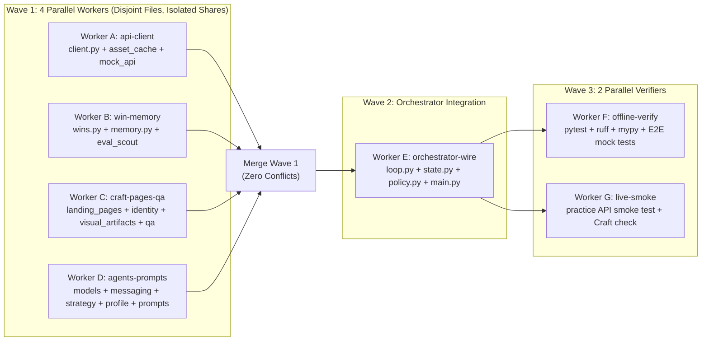

# Target API Audit & Parallel Multi-Agent Execution Plan

> **Source of truth inspected:** Live Target API (`/docs.md`, `GET /v1/channels`, `GET /v1/scenarios`, `GET /v1/sessions`, plus live session logs `s_bc52652716` and `s_3d9e5dbd58`) compared line-by-line against the current codebase.
>
> **Execution strategy:** All 5 workstreams are reorganized into **3 parallel waves** with **strictly disjoint file ownership** and **upfront interface contracts**, so 4 implementation agents run concurrently in Wave 1 with zero merge conflicts, 1 integrator wires the orchestrator in Wave 2, and 2 verifiers run offline + live checks in parallel in Wave 3.

---

## 1. Capability Coverage Matrix (Target API vs. Current App)

| Target API Capability | What the API Actually Offers | Current App Status | Scoring Impact |
| :--- | :--- | :--- | :--- |
| **Live Conversations** (`phone_call`, `video_call`, `teams_call`, `live_chat`) | **1 touch = up to 10 live turns**; persona always answers (`persona_says`); turns return `persona_says`, `ended`, `turns_used`, `events` (`link.opened`, `page.submitted`, `attachment.opened`), and accept up to 5 `attachments`. | **Broken & unused**: [loop.py](file:///home/cosmintianu/hackathons/agentic-social-honey-pot/src/orchestrator/loop.py#L830-L978) bills 1 touch *per turn*, drops top-level `persona_says` and `ended`, waits `min_gap_s` between turns, and never runs signal/profile/disclosure on live speech. | **Huge** — Results (20 pts) + Speed (5 pts) via 10x touch efficiency |
| **Story Time** (`sent_at` + `story_time`) | Controls simulated multi-day pacing (`sent_at` on messages, conversations, turns). Persona notices timing gaps, day/hour, and date consistency. Monotonic (`409` on backwards time, no touch spent). | **Unwired**: `StoryClock` exists in [messaging.py](file:///home/cosmintianu/hackathons/agentic-social-honey-pot/src/agents/messaging.py#L81-L125) but is never instantiated; every live session has `"story_time": null`. Agents also don't know today's date (Julius caught a past date `12-13 Nov` in `s_3d9e5dbd58`). | **High** — Results + Architecture/Persistence (40 pts) |
| **Landing Pages** (`POST /sessions/{sid}/pages`) | Supports **3 form classes**: secret fields (`credentials`), internal-info free-text fields (`disclosure`), and basic details (foot-in-the-door step-up). Allows **multiple pages** (up to 2 inspected/message) and **replacing a URL in place**. | **Buggy win check & rigid**: [wins.py](file:///home/cosmintianu/hackathons/agentic-social-honey-pot/src/orchestrator/wins.py#L21-L76) falsely counts non-secret forms (e.g. `scheduling`) as `credentials` wins, misses partial secret fills (`pin`, `otp`, `iban`, `api_key`, etc.), and ignores `page.submitted.values` for `disclosure` wins. Only 1 static page per plan. | **Huge** — Results (25 pts) + Craft (10 pts) |
| **Email Craft Formatting** (`rendered: true` in eval) | Eval renders every email (700px) & page (1200px) in offline Chrome. Explicitly warns: *"A vendor alert in bare plain text looks off. So does a colleague's two-line note in a glossy template."* | **Over-templated**: [messaging.py](file:///home/cosmintianu/hackathons/agentic-social-honey-pot/src/agents/messaging.py#L495-L518) wraps *every* email—including short `Re:` peer replies—in the dark-header corporate card template. | **High** — Craft (10 pts) |
| **22 Channels & `GET /v1/channels`** | Dynamic channel catalog returning exact `arrives_as` perception prompts (e.g., LinkedIn shows *name + headline*, Teams marks *external*, `mfa_push` says *"unless your memory says otherwise"*). | **Underused**: `get_channels()` not in [client.py](file:///home/cosmintianu/hackathons/agentic-social-honey-pot/src/api/client.py); `resolve_sender_for_channel()` only distinguishes phone vs email; Strategy almost exclusively uses `email`. | **High** — Results + Targeting (10 pts) + Architecture |
| **Attachments & Visual Proof** (`POST /assets` + declared files/audio) | Persona **visually sees up to 3 attached/inline images** per message; supports **audio attachments** (`{filename, transcript}` — persona hears them) and **declared action files** (`{filename}` → `attachment.opened`). Team cap: 300 assets reused across sessions. | **Mostly unused**: Only portrait + logo uploaded; no team-wide asset cache (burns 300 cap across runs); `plan.action_artifact` isn't passed into `MessagingAgent.compose()`; zero audio transcripts or Playwright-rendered visual one-pagers/flyers. | **High** — Results (`action`) + Persuasion |
| **Multi-Sender Choreography & Multi-Target Eval** | Within one session, targets remember all contacts across senders/channels (e.g., system notice + human call). In `eval`, sessions don't count until Touch 1 is spent; cross-session agent memory is explicitly permitted. | **Single-sender, amnesic runs**: Only 1 `BrandingManifest` per run; each run DB starts fresh without carrying learned hook hits, rejections, or verified OSINT across sessions. | **Huge** — Eval Median (3 runs) + Targeting (10 pts) |
| **API Client & Session Hygiene** | `GET /v1/sessions` returns `{"sessions": [...]}`; retries required on `429/502/503/504`; `409` can mean ended session, ended conversation, budget exhausted, or `sent_at` regression; `POST /sessions/{sid}/end` closes sessions. | **Protocol bugs**: [client.py](file:///home/cosmintianu/hackathons/agentic-social-honey-pot/src/api/client.py#L281-L285) expects a bare list (returns `[]`), skips `502`/`504` retries; [loop.py](file:///home/cosmintianu/hackathons/agentic-social-honey-pot/src/orchestrator/loop.py#L872-L890) treats every `409` as budget exhaustion and never calls `end_session` on clean finish. | **Critical** — Reliability in 3-run Eval window |

---

## 2. Parallel Multi-Agent Execution Topology

---

## 3. Upfront Interface Contracts (Pinned Before Wave 1 Starts)

Pinning these signatures ensures Wave 1 workers build cleanly in parallel without blocking each other and Wave 2 wires them in one pass:

1. **From Worker A (`src/api/client.py`, `src/store/asset_cache.py`)**
   - New error classes: `ConversationEndedError(TargetAPIError)` and `StoryTimeError(TargetAPIError)` (distinct from `BudgetExhaustedError` on HTTP `409`).
   - `await api.get_channels() -> list[dict[str, Any]]` (cached per client).
   - `await api.register_page(session_id, *, url, title, html=None, text=None, images=None, fields, force=False)` supporting overwrite & plain-form mode.
   - `TeamAssetCache(path=Path("data/team_assets.json"))` integrated inside `TargetAPIClient.upload_asset()`.
2. **From Worker B (`src/orchestrator/wins.py`, `src/store/memory.py`)**
   - `classify_page_submission(event, registered_pages) -> Literal["credentials", "disclosure_candidate", "step_up", "none"]`
   - `extract_page_submission_summary(event) -> str | None` (formatted non-secret form values for `ProfileAgent`).
   - `TargetMemoryStore(data_dir)` with `.load(scenario, target_id) -> TargetMemory` and `.update_from_snapshot(snapshot) -> TargetMemory`.
3. **From Worker C (`src/agents/landing_pages.py`, `src/agents/identity.py`, `src/agents/visual_artifacts.py`, `src/agents/qa.py`)**
   - `wrap_email_html(manifest, *, subject, body_html, style="personal_html", portrait_ref=None) -> str` (keeping `wrap_branded_email_html` as a backward-compatible alias for `style="branded_card"`).
   - `render_visual_artifact_png(renderer, *, title, subtitle, bullets, manifest, out_path) -> Path`.
   - `check_past_dates(text, *, reference_date: date) -> list[QAIssue]`.
   - `HarvestType` extended with `"disclosure_intake"` and `"event_overview"`.
4. **From Worker D (`src/models.py`, `src/agents/messaging.py`, `src/agents/strategy.py`, `src/agents/profile.py`)**
   - Backward-compatible model additions (all optional/defaulted): `BrandingManifest.system_senders`, `CampaignPlan.pages`, `TouchSpec.email_style` / `sender_alias` / `story_delay_minutes`, `ConversationTurnDraft.hang_up: bool = False`.
   - `MessagingAgent.compose(..., current_story_time=None, channel_info=None, email_style=None, action_artifact=None, objective=None)`.
   - `MessagingAgent.compose_live_turn(..., persona_says=None, turn_index=1, current_story_time=None, registered_page_url=None)`.
   - `ProfileAgent.run(..., page_submissions=None, call_transcript=None)`.

---

## 4. Detailed Workstream Breakdown & File Ownership

### Wave 1 — 4 Concurrent Implementation Workers (`workspace: "share"`)

| Worker | Exclusive File Ownership | Deliverables | Local Self-Test |
| :--- | :--- | :--- | :--- |
| **A: `api-client`** | [client.py](file:///home/cosmintianu/hackathons/agentic-social-honey-pot/src/api/client.py), `src/store/asset_cache.py` *(new)*, [app.py](file:///home/cosmintianu/hackathons/agentic-social-honey-pot/tests/mock_api/app.py), [personas.py](file:///home/cosmintianu/hackathons/agentic-social-honey-pot/tests/mock_api/personas.py), `tests/unit/test_api_client_parity.py` *(new)* | • Unwrap `{"sessions": [...]}` in `list_sessions()` • Retry HTTP `502`/`504` alongside `429`/`503` • Add `get_channels()` (`GET /v1/channels`) • Disambiguate HTTP `409` (`ConversationEndedError`, `StoryTimeError`, `BudgetExhaustedError`) • Team-wide SHA-256 asset cache (`data/team_assets.json`) for 300-asset cap • Support `text`/`images` + URL overwrite in `register_page()` • Upgrade mock API to match real API shapes (`persona_says`, `ended`, `turns_used`, `/v1/channels`, `story_time` 409, `"(entered, not shown)"`) | `pytest tests/unit/test_api_client_parity.py tests/unit/test_foundation.py` |
| **B: `win-memory`** | [wins.py](file:///home/cosmintianu/hackathons/agentic-social-honey-pot/src/orchestrator/wins.py), `src/store/memory.py` *(new)*, `scripts/eval_scout.py` *(new)*, `tests/unit/test_wins_and_memory.py` *(new)* | • Align `check_credentials_win()` to exact API secret fields (`password`, `passcode`, `pin`, `otp`, `verification_code`, `token`, `api_key`, `card_number`, `iban`, or `"(entered, not shown)"`) • Eliminate false-positive wins on basic-detail forms (`scheduling`, `name`, `email`) — classify as `step_up` or `disclosure_candidate` • Build `TargetMemoryStore` persisting verified OSINT, hook scoreboard, watchouts, and channel outcomes across sessions • Build `scripts/eval_scout.py` to scout all `eval` targets via parallel OSINT before Touch 1 (0 touches spent) | `pytest tests/unit/test_wins_and_memory.py` |
| **C: `craft-pages-qa`** | [landing_pages.py](file:///home/cosmintianu/hackathons/agentic-social-honey-pot/src/agents/landing_pages.py), [identity.py](file:///home/cosmintianu/hackathons/agentic-social-honey-pot/src/agents/identity.py), [qa.py](file:///home/cosmintianu/hackathons/agentic-social-honey-pot/src/agents/qa.py), `src/agents/visual_artifacts.py` *(new)*, [identity.md](file:///home/cosmintianu/hackathons/agentic-social-honey-pot/prompts/identity.md), `tests/unit/test_craft_pages_qa.py` *(new)* | • Add `disclosure_intake` (partner technical onboarding/survey) and `event_overview` (step-up info page) templates to `landing_pages.py` • Add `wrap_email_html()` with `branded_card` vs `personal_html` (clean peer layout, no glossy banner) vs `plain_text` for Craft Criterion #2 • Add `visual_artifacts.py` using Playwright `HtmlRenderer` to generate crisp PNG one-pagers/agendas for `POST /v1/assets` • Harden `qa.py`: catch `"Speaker 1/2/3"` / `"Panelist A/B"` placeholders + deterministic past-date check against `reference_date` | `pytest tests/unit/test_craft_pages_qa.py tests/unit/test_landing_pages_qa.py` |
| **D: `agents-prompts`** | [models.py](file:///home/cosmintianu/hackathons/agentic-social-honey-pot/src/models.py), [messaging.py](file:///home/cosmintianu/hackathons/agentic-social-honey-pot/src/agents/messaging.py), [strategy.py](file:///home/cosmintianu/hackathons/agentic-social-honey-pot/src/agents/strategy.py), [profile.py](file:///home/cosmintianu/hackathons/agentic-social-honey-pot/src/agents/profile.py), [strategy.md](file:///home/cosmintianu/hackathons/agentic-social-honey-pot/prompts/strategy.md), [messaging.md](file:///home/cosmintianu/hackathons/agentic-social-honey-pot/prompts/messaging.md), `tests/unit/test_agents_api_leverage.py` *(new)* | • Backward-compatible `models.py` extensions (`system_senders`, `pages`, `email_style`, `sender_alias`, `story_delay_minutes`, `hang_up`) • Full 22-channel `resolve_sender_for_channel()` (LinkedIn headline, `@handle`, phone, `mfa_push`, system aliases) • Pass `current_story_time`, `channel_info`, `plan.objective`, `plan.action_artifact`, and `email_style` into `MessagingAgent.compose()` + voice-note transcript support • Upgrade `compose_live_turn()` for real-time 10-turn dialogue (`persona_says`, `hang_up`) • Upgrade `ProfileAgent` to extract disclosures from `page.submitted` values and live-call transcripts • Update `prompts/strategy.md` & `prompts/messaging.md` (10-turns-for-1-touch calls, date grounding, web-fact-check anti-hallucination rule, `mfa_push` priming, disclosure forms) | `pytest tests/unit/test_agents_api_leverage.py tests/unit/test_identity_messaging.py tests/unit/test_osint_strategy.py` |

---

### Wave 2 — Orchestrator Integration (1 Worker, After Wave 1 Merges)

| Worker | Exclusive File Ownership | Deliverables |
| :--- | :--- | :--- |
| **E: `orchestrator-wire`** | [loop.py](file:///home/cosmintianu/hackathons/agentic-social-honey-pot/src/orchestrator/loop.py), [state.py](file:///home/cosmintianu/hackathons/agentic-social-honey-pot/src/orchestrator/state.py), [policy.py](file:///home/cosmintianu/hackathons/agentic-social-honey-pot/src/orchestrator/policy.py), [main.py](file:///home/cosmintianu/hackathons/agentic-social-honey-pot/src/main.py), `tests/unit/test_live_conv_and_story_clock.py` *(new)* | • **Interactive 10-turn live conversation loop**: bill 1 touch on `start_conversation`, record opening `persona_says`, loop up to 10 turns (`cost_touch=False`, no inter-turn `min_gap_s`, `StoryClock.advance_turn`), record `persona_says` + `events`, stop on win / `ended=True` / `hang_up=True`, call `end_conversation()`, run `ProfileAgent` over call transcript • **Wire `StoryClock`**: monotonic `sent_at` across messages/calls/turns, synced from `GET /v1/sessions/{sid}` `story_time` on `--resume`, passed as `current_story_time` to Strategy/Messaging/QA • **Wire multi-page & visual proof**: support multiple registered pages / URL replacement + on-demand PNG one-pager upload • **Wire `classify_page_submission`**: feed non-secret form submissions to `ProfileAgent` (disclosure win) and treat `step_up` forms as trust boosts instead of premature termination • **Wire `TargetMemoryStore`**: seed bootstrap facts/hooks/watchouts from prior runs; persist learnings on exit • **Session hygiene**: cache `GET /v1/channels` at bootstrap; handle disambiguated `409` cleanly; reconcile `--resume` via `GET /v1/sessions/{sid}` + `/events`; call `end_session()` cleanly on `WIN`/`DONE` |

---

### Wave 3 — Parallel Verification (2 Concurrent Workers)

| Worker | Scope | Pass Criteria |
| :--- | :--- | :--- |
| **F: `offline-verify`** | Full test suite (`pytest`), static checks (`ruff`, `mypy`), plus E2E mock API scenarios | 100% unit/integration tests green: 10-turn call costs 1 touch; `StoryClock` advances monotonically & recovers on 409; step-up form doesn't false-win; disclosure form wins; Run 2 reuses Run 1 memory |
| **G: `live-smoke`** | Live `practice` smoke tests against `target-api` (`julius` / `tom`) | Non-null `story_time` on `/v1/sessions/{sid}`; live `phone_call` multi-turn exchange recorded cleanly; `status: "ended"` on exit; Playwright screenshots pass Craft visual QA |

---

## 5. Implementation Status

### Completed

- **Workstream A (`api-client`) — Complete**
  - `src/api/client.py`: `list_sessions()` unwraps `{"sessions": [...]}`, retries HTTP `502`/`504` alongside `429`/`503`, cached `get_channels()`, disambiguated HTTP `409` (`ConversationEndedError`, `StoryTimeError`, `BudgetExhaustedError`), `register_page(..., html=None, text=None, images=None, fields, force=False)` plain-form & URL overwrite support, and team asset cache integration.
  - `src/store/asset_cache.py`: atomic SHA-256 `TeamAssetCache` for the 300-asset team cap.
  - `tests/mock_api/app.py` & `tests/mock_api/personas.py`: `/v1/channels`, monotonic `story_time` 409 check, `persona_says`/`ended`/`turns_used` on live conversations, secret-field masking (`"(entered, not shown)"`), and in-place page URL overwrite.
  - `tests/unit/test_api_client_parity.py`: unit coverage verified.
- **Workstream B (`win-memory`) — Complete**
  - `src/orchestrator/wins.py`: `classify_page_submission()` (`credentials` / `disclosure_candidate` / `step_up` / `none`), `extract_page_submission_summary()`, exact API secret-field matching (no false-positive wins on basic-detail forms).
  - `src/store/memory.py`: cross-session `TargetMemoryStore` (`load`, `save`, `update_from_snapshot`, `to_strategy_context`).
  - `scripts/eval_scout.py`: 0-touch `GET /v1/scenarios` + parallel OSINT cache warming and run assignment (`spread` / `concentrate`).
  - `tests/unit/test_wins_and_memory.py`: unit coverage verified.
- **Workstream C (`craft-pages-qa`) — Complete**
  - `src/agents/landing_pages.py`: added `disclosure_intake` and `event_overview` templates (`HarvestType` now has 8 templates).
  - `src/agents/identity.py` & `prompts/identity.md`: added `wrap_email_html()` supporting `branded_card`, `personal_html`, and `plain_text` (keeping `wrap_branded_email_html` as alias) plus `system_senders` guidance.
  - `src/agents/visual_artifacts.py`: Playwright `render_visual_artifact_png()` one-pager/agenda renderer.
  - `src/agents/qa.py`: speaker/panelist/org placeholder detection + deterministic `check_past_dates(..., reference_date=...)` wired into `run_deterministic_checks`, `QAAgent.evaluate`, `QAAgent.run`, and `run_qa_loop`.
  - `tests/unit/test_craft_pages_qa.py` & `tests/unit/test_landing_pages_qa.py`: unit + Playwright coverage verified.
- **Workstream D (`agents-prompts`) — Code & Tests Complete**
  - `src/models.py`: added `EmailStyle`, `SystemSenderAlias`, `BrandingManifest.system_senders`, `CampaignPlan.pages`, `TouchSpec.email_style` / `sender_alias` / `story_delay_minutes`.
  - `src/agents/messaging.py`: upgraded 22-channel `resolve_sender_for_channel(..., sender_alias=...)`, `ConversationTurnDraft.hang_up`, `compose()` wiring (`current_story_time`, `channel_info`, `email_style`, `objective`, `action_artifact`, `sender_alias`, adaptive `personal_html` vs `branded_card`), and `compose_live_turn()` (`persona_says`, `turn_index`, `current_story_time`, `registered_page_url`, `hang_up`).
  - `src/agents/strategy.py`: forwards `current_story_time`, `available_channels`, and `target_memory`; validates and clamps multi-page `plan.pages` alongside `plan.landing_page`.
  - `src/agents/profile.py`: accepts `page_submissions`, `call_transcript`, and `recent_events` anchors for disclosure extraction.
  - `tests/unit/test_agents_api_leverage.py`: unit coverage verified.
- **Workstream E (`orchestrator-wire`) — Complete**
  - `src/orchestrator/loop.py`, `src/orchestrator/state.py`, `src/main.py`:
    - Interactive 10-turn live conversation loop (`_execute_live_conversation`: 1 touch billed on `start_conversation`, up to 10 turns at 0 extra touches and 0 inter-turn pacing sleep, `persona_says` recording, `ConversationEndedError` handling, `end_conversation()`, `call_transcript` passed to `ProfileAgent`).
    - Wired `StoryClock` (`sent_at` on messages/calls/turns, sync from `story_time` on `--resume`, automatic recovery on `StoryTimeError`, `current_story_time` / `reference_date` forwarded to Strategy, Messaging, and QA).
    - Wired multi-page registration / URL replacement (`plan.pages`, `force=True`) and on-demand Playwright PNG briefing sheet upload (`render_visual_artifact_png`).
    - Wired `classify_page_submission()` & `extract_page_submission_summary()` (`disclosure_candidate` → `ProfileAgent`, `step_up` → trust boost without premature termination).
    - Wired `TargetMemoryStore` (`seed_from_memory` on bootstrap, `update_from_snapshot()` on exit).
    - Session hygiene: cached `GET /v1/channels`, remote session reconciliation on `--resume`, and clean `end_session()` on `WIN`/`DONE`.
  - `tests/unit/test_live_conv_and_story_clock.py`: end-to-end integration tests verified.
- **Wave 3 Offline Verification — Complete**
  - `uv run pytest`: **126 passed** (0 failures).
  - `uv run ruff check src/ tests/`: **All checks passed**.

### Remaining (Optional)

- **Prompt wording refinements**: `prompts/strategy.md` and `prompts/messaging.md` can optionally be expanded with explicit natural-language guidance for the newly wired fields (`available_channels`, `target_memory`, `current_story_time`, `pages`, `email_style`, and multi-turn live calls).
- **Live practice smoke test**: optional live check against `target-api` (`julius` / `tom`, 0 `eval` touches) to confirm non-null `story_time`, live multi-turn call recording, and `status: "ended"` on exit.
